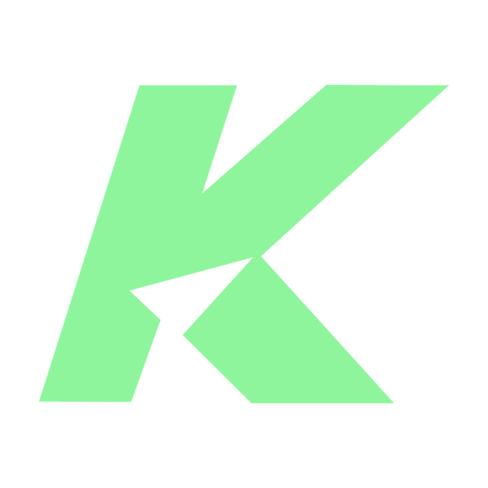

<picture>
  <source media="(prefers-color-scheme: dark)" srcset="assets/header-dark.svg">
  <source media="(prefers-color-scheme: light)" srcset="assets/header-light.svg">
  
</picture>

**Stellarr Studio** is a French artificial intelligence studio based in Pont-Audemer, Normandy, working with organisations across France. We train and evaluate models, build the products that put them to work, and connect them to the tools people already use, with data control at the heart of every project. Open source comes first, and every technical choice is explained.

 

<picture>
  <source media="(prefers-color-scheme: dark)" srcset="assets/moonai-dark.png">
  <source media="(prefers-color-scheme: light)" srcset="assets/moonai-light.png">
  
</picture>

### [Moon AI](https://realmoon.ai): one workspace, more than 100 models

Claude, GPT, Gemini, Mistral and more in a single subscription, hosted in France, to write, create, search and automate.

- **Moon Blur** detects personal data such as e-mails, phone numbers, IBANs, card numbers and API keys, and masks it before anything reaches a model.
- **Moon6**, our model, is published on Ollama to run locally.
- **Moon OCR** turns a scanned page into Markdown, also on Ollama.
- Free to start, then from €9.90 a month.

 

### [Kelvaroq](https://github.com/stellarr-studio/kelvaroq): an Xbox Series compatibility runtime for Windows

Written in Rust on DirectX 12, and built entirely with Moon AI. Its new memory layer gives the GPU the game's own memory, the way the console does, instead of copying it back and forth every frame.

<picture>
  <source media="(prefers-color-scheme: dark)" srcset="assets/kelvaroq-highlights-dark.svg">
  <source media="(prefers-color-scheme: light)" srcset="assets/kelvaroq-highlights-light.svg">
  
</picture>

 

### What we build for organisations

| | |
|---|---|
| 🧠 **Custom models** | Data preparation, adaptation, training and evaluation, built around a real use case. |
| 🔌 **AI integration** | Document assistants grounded in your sources, process automation, assistants inside the tools your teams already use. |
| 🛠️ **Business apps** | Internal applications and customer-facing services, designed, built and connected to your information system. |
| 🔐 **Data architecture** | Hosting, access rights, data flows and retention, designed for each organisation's constraints. |

### How we work

- **Open source first**: Ollama, vLLM, PyTorch, Transformers, PostgreSQL, Qdrant, Keycloak, Nextcloud, Kubernetes, OpenTofu, Prometheus and Grafana.
- **The right access, not all access**: users, sources and permissions are part of the design from day one.
- **Transparent choices**: providers, processing and hosting are explained.

Featured in **France 3 Normandie**, **BFM Normandie**, **Le Parisien**, **Ouest-France**, **Paris-Normandie** and **Actu.fr**.

 

  
  
  

